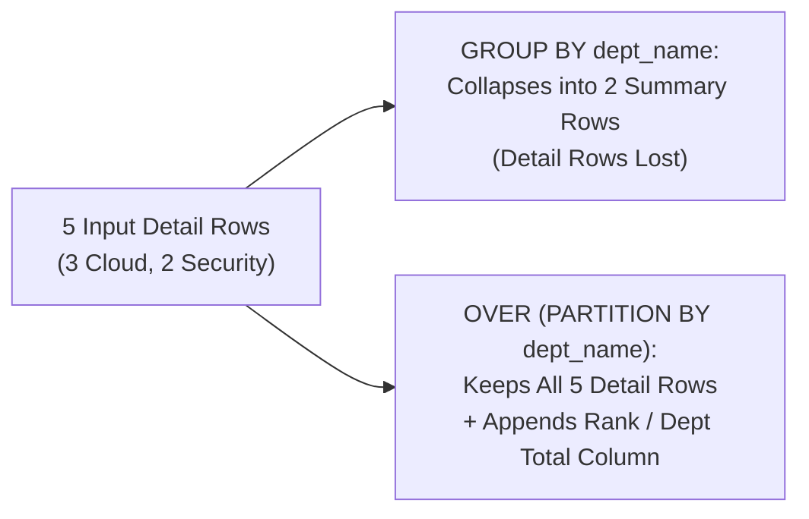

---
tags:
  - sql
  - window-functions
  - advanced-sql
---

# Window Functions (ROW_NUMBER, RANK, LEAD, LAG) in SQL

#### TL;DR (Quick Revision)

**Window Functions (`OVER (PARTITION BY ... ORDER BY ...)`)** = Compute rankings (`ROW_NUMBER`, `RANK`, `DENSE_RANK`), row-to-row offsets (`LAG`, `LEAD`), and running totals (`SUM() OVER`) across a sliding window of rows **without collapsing the individual detail rows like `GROUP BY` does**!

> [!abstract] Core Idea
> While `GROUP BY` collapses all rows in a department into a single summary row, a **Window Function** evaluates an aggregate, ranking, or offset function across a defined set of related rows (the **Window**) while **preserving 100% of the individual detail rows** ([MySQL 8.4 Window Function Usage](https://dev.mysql.com/doc/refman/8.4/en/window-functions-usage.html)). Because Window Functions are evaluated inside the **`SELECT` (Step 5)** and **`ORDER BY` (Step 7)** clauses, they cannot be placed directly in `WHERE`, `GROUP BY`, or `HAVING`—you filter them by wrapping the query in a CTE! `[VERIFY]`

> [!question] Why Use It?
>
> - **Top-N Per Group & Deduplication (`ROW_NUMBER`, `RANK`, `DENSE_RANK`)**: Find the top 2 earners in *each* department or delete duplicate log rows cleanly.
> - **Month-over-Month Growth Without Self-Joins (`LAG` & `LEAD`)**: Peek at the previous month's revenue (`LAG(rev_usd, 1)`) or next month's revenue (`LEAD(rev_usd, 1)`) on the exact same row!
> - **Running Totals & Moving Averages (`SUM() / AVG() OVER`)**: Compute cumulative Year-to-Date (`YTD`) revenue or a 3-month rolling average alongside each month's raw sales.
> - **Compare Detail to Group Total on One Pass**: Calculate `rev_usd / SUM(rev_usd) OVER (PARTITION BY dept_name)` (percentage of department total) without a derived table join.

#### Quick Comparison Table

| Window Function | Syntax (`OVER (PARTITION BY ... ORDER BY ...)`) | How It Handles Ties (e.g., Two `$90k` Scores) | Primary Production Use Case |
| :--- | :--- | :--- | :--- |
| **`ROW_NUMBER()`** | `ROW_NUMBER() OVER (PARTITION BY dept ORDER BY rev DESC)` | **Unique sequential integers** (`1, 2, 3`); never ties! | Deduplicating rows (`WHERE rn = 1`), exact pagination. |
| **`RANK()`** | `RANK() OVER (PARTITION BY dept ORDER BY rev DESC)` | **Same rank on ties, skips next number** (`1, 1, 3`)—leaves a gap! | Olympic-style leaderboards where two gold medals skip silver (`3rd` place next). |
| **`DENSE_RANK()`** | `DENSE_RANK() OVER (PARTITION BY dept ORDER BY rev DESC)` | **Same rank on ties, NO gap** (`1, 1, 2`)! | "Find the 2nd highest distinct salary in each department" (`WHERE dense_rnk = 2`). |
| **`LAG(col, offset, default)`** | `LAG(rev_usd, 1, 0.00) OVER (ORDER BY month_num ASC)` | Looks **backward** `offset` rows (default `1`) in the ordered partition. | Month-over-Month (`MoM`) or Year-over-Year (`YoY`) delta calculations. |
| **`LEAD(col, offset, default)`** | `LEAD(rev_usd, 1, 0.00) OVER (ORDER BY month_num ASC)` | Looks **forward** `offset` rows (default `1`) in the ordered partition. | Calculating time elapsed until a user's *next* order or session event. |
| **Window Aggregates (`SUM`, `AVG`, `COUNT`, `MIN`, `MAX`)** | `SUM(rev_usd) OVER (PARTITION BY dept ORDER BY month_num ROWS BETWEEN UNBOUNDED PRECEDING AND CURRENT ROW)` | Computes a running total or partition total across the window frame. | Running totals, moving 7-day averages, and `% of department total`. |

---

## The Learning Concept

### What Problem Does It Solve?

Suppose an interviewer asks: *"Find the Top 2 highest-earning employees in EACH department, and handle ties properly."* Without Window Functions, you would have to write slow, complex correlated subqueries counting how many people earn more than each employee. Even with Window Functions, two classic mistakes occur:
1. Trying to filter `WHERE DENSE_RANK() OVER (...) <= 2` directly inside the `WHERE` clause (which fails because `WHERE` runs at Step 2, while Window Functions don't run until Step 5 `SELECT`!).
2. Confusing `ROW_NUMBER()`, `RANK()`, and `DENSE_RANK()` when two employees tie for 1st place (`Ananya` and `Vikram` both at `$90,000`):

```sql
-- BAD - Putting a Window Function inside WHERE fails with a syntax/execution-order error!
SELECT emp_id, emp_name, dept_name, revenue_generated
FROM employee_perf_scores
WHERE DENSE_RANK() OVER (PARTITION BY dept_name ORDER BY revenue_generated DESC) <= 2;
-- ERROR: Window functions can only appear in SELECT or ORDER BY!
```

To filter on the result of a Window Function, compute the window function inside a **CTE** (or derived table) first, and then filter `WHERE dense_rnk <= 2` in the outer `SELECT`:

```sql
-- GOOD - Computing DENSE_RANK() inside a CTE (Step 5 of CTE) and filtering in the outer WHERE!
WITH ranked_scores AS (
    SELECT
        emp_id,
        emp_name,
        dept_name,
        revenue_generated,
        DENSE_RANK() OVER (
            PARTITION BY dept_name
            ORDER BY revenue_generated DESC
        ) AS dense_rnk
    FROM employee_perf_scores
)
SELECT emp_id, emp_name, dept_name, revenue_generated, dense_rnk
FROM ranked_scores
WHERE dense_rnk <= 2;
```

### How SQL Implements It

> [!tip] Anatomy of the `OVER (...)` Clause (3 Optional Parts)
>
> 1. **`PARTITION BY dept_name`**: Splits the table into independent sub-groups (windows) by department. The ranking or running total resets back to `1` (or `0`) at each new department boundary. *(If omitted, the entire table is treated as one big partition!)*
> 2. **`ORDER BY revenue_generated DESC`**: Defines the sort order **inside** each partition for `ROW_NUMBER`, `RANK`, `DENSE_RANK`, `LAG`, `LEAD`, and running totals.
> 3. **Window Frame (`ROWS BETWEEN ...`)**: For window aggregates (`SUM`, `AVG`) and `LAST_VALUE`, specifies which slice of rows around the current row to include (e.g., `ROWS BETWEEN UNBOUNDED PRECEDING AND CURRENT ROW`).

#### Full Runnable Example

```sql
-- Step 1: Create employee_perf_scores (with a $90k tie in Cloud!) and monthly_revenue tables
CREATE TABLE employee_perf_scores (
    emp_id INT PRIMARY KEY,
    emp_name VARCHAR(40) NOT NULL,
    dept_name VARCHAR(30) NOT NULL,
    review_quarter CHAR(2) NOT NULL,
    revenue_generated DECIMAL(10, 2) NOT NULL
);

INSERT INTO employee_perf_scores VALUES
(101, 'Ananya', 'Cloud', 'Q1', 90000.00),
(102, 'Vikram', 'Cloud', 'Q1', 90000.00),
(103, 'Siddharth', 'Cloud', 'Q1', 75000.00),
(104, 'Kavya', 'Security', 'Q1', 82000.00),
(105, 'Prashanth', 'Security', 'Q1', 68000.00);

CREATE TABLE monthly_revenue (
    month_num INT PRIMARY KEY,
    month_label VARCHAR(10) NOT NULL,
    rev_usd DECIMAL(10, 2) NOT NULL
);

INSERT INTO monthly_revenue VALUES
(1, '2026-01', 100000.00),
(2, '2026-02', 120000.00),
(3, '2026-03', 115000.00),
(4, '2026-04', 150000.00);

-- Step 2A: Compare ROW_NUMBER (1, 2, 3) vs RANK (1, 1, 3) vs DENSE_RANK (1, 1, 2) on tied $90k Cloud scores
SELECT
    emp_id,
    emp_name,
    dept_name,
    revenue_generated,
    ROW_NUMBER() OVER (PARTITION BY dept_name ORDER BY revenue_generated DESC, emp_id ASC) AS row_num,
    RANK()       OVER (PARTITION BY dept_name ORDER BY revenue_generated DESC) AS rnk_with_gap,
    DENSE_RANK() OVER (PARTITION BY dept_name ORDER BY revenue_generated DESC) AS dense_rnk_no_gap
FROM employee_perf_scores
ORDER BY dept_name ASC, row_num ASC;
```

**Output (Query 2A - `ROW_NUMBER` vs. `RANK` vs. `DENSE_RANK` on Tied Scores):**

```
+----------+------------+-------------+---------------------+-----------+----------------+--------------------+
| emp_id   | emp_name   | dept_name   | revenue_generated   | row_num   | rnk_with_gap   | dense_rnk_no_gap   |
|----------+------------+-------------+---------------------+-----------+----------------+--------------------|
| 101      | Ananya     | Cloud       | 90000               | 1         | 1              | 1                  |
| 102      | Vikram     | Cloud       | 90000               | 2         | 1              | 1                  |
| 103      | Siddharth  | Cloud       | 75000               | 3         | 3              | 2                  |
| 104      | Kavya      | Security    | 82000               | 1         | 1              | 1                  |
| 105      | Prashanth  | Security    | 68000               | 2         | 2              | 2                  |
+----------+------------+-------------+---------------------+-----------+----------------+--------------------+
```

```sql
-- Step 2B: Month-over-Month change with LAG() and YTD Running Total with SUM() OVER (ROWS BETWEEN...)
SELECT
    month_num,
    month_label,
    rev_usd,
    COALESCE(CAST(LAG(rev_usd, 1) OVER (ORDER BY month_num ASC) AS VARCHAR), 'FIRST_MONTH') AS prev_month_rev,
    COALESCE(CAST(rev_usd - LAG(rev_usd, 1) OVER (ORDER BY month_num ASC) AS VARCHAR), 'N/A') AS mom_change,
    SUM(rev_usd) OVER (
        ORDER BY month_num ASC
        ROWS BETWEEN UNBOUNDED PRECEDING AND CURRENT ROW
    ) AS ytd_running_total
FROM monthly_revenue
ORDER BY month_num ASC;
```

**Output (Query 2B - `LAG()` Month-over-Month Delta & Running Total):**

```
+-------------+---------------+-----------+------------------+--------------+---------------------+
| month_num   | month_label   | rev_usd   | prev_month_rev   | mom_change   | ytd_running_total   |
|-------------+---------------+-----------+------------------+--------------+---------------------|
| 1           | 2026-01       | 100000    | FIRST_MONTH      | N/A          | 100000              |
| 2           | 2026-02       | 120000    | 100000           | 20000        | 220000              |
| 3           | 2026-03       | 115000    | 120000           | -5000        | 335000              |
| 4           | 2026-04       | 150000    | 115000           | 35000        | 485000              |
+-------------+---------------+-----------+------------------+--------------+---------------------+
```

### Visual Diagram: `GROUP BY` vs. Window Functions (`OVER`)



### Key Terminology

1. **`PARTITION BY`**: Divides the query result set into independent partitions (sub-groups) to which the window function is applied separately.
   Syntax: `SUM(revenue_generated) OVER (PARTITION BY dept_name)`
2. **`ROW_NUMBER()` vs. `RANK()` vs. `DENSE_RANK()`**: For values `(90k, 90k, 75k)`:
   - `ROW_NUMBER()` assigns **`1, 2, 3`** (no ties allowed).
   - `RANK()` assigns **`1, 1, 3`** (ties share rank `1`, skips `2`).
   - `DENSE_RANK()` assigns **`1, 1, 2`** (ties share rank `1`, never skips numbers).
   Syntax: `DENSE_RANK() OVER (PARTITION BY dept_name ORDER BY revenue_generated DESC)`
3. **`LAG(col, n, default)` and `LEAD(col, n, default)`**: Accesses a column value from `n` rows **before** (`LAG`) or `n` rows **after** (`LEAD`) the current row within the same partition, returning `default` (or `NULL` if omitted) at the partition boundary.
   Syntax: `LAG(rev_usd, 1, 0.00) OVER (ORDER BY month_num ASC)`
4. **Window Frame (`ROWS` vs. `RANGE`)**: Defines the sliding subset of rows within a partition: `ROWS BETWEEN 2 PRECEDING AND CURRENT ROW` counts exactly 2 physical rows back (e.g., 3-month moving average), whereas `RANGE` groups tied `ORDER BY` peer values together!
   Syntax: `AVG(rev_usd) OVER (ORDER BY month_num ROWS BETWEEN 2 PRECEDING AND CURRENT ROW)`

> [!important] Key Rules to Remember
>
> - **Where Window Functions Are Allowed** → Window functions execute at **Step 5 (`SELECT`)** and **Step 7 (`ORDER BY`)**—meaning they see the result set *after* `FROM`, `WHERE`, `GROUP BY`, and `HAVING` have already filtered the rows! Never put a window function directly inside `WHERE`, `GROUP BY`, or `HAVING`.
> - **Default Window Frame Trap (`RANGE` vs. `ROWS`)** → When you add `ORDER BY` inside `SUM(col) OVER (ORDER BY x)` without specifying a frame, SQL defaults to **`RANGE BETWEEN UNBOUNDED PRECEDING AND CURRENT ROW`**. If two rows tie on `x`, `RANGE` adds **both** tied rows into the running total at the same time! Always write `ROWS BETWEEN UNBOUNDED PRECEDING AND CURRENT ROW` for strict row-by-row running totals.
> - **The `LAST_VALUE()` Default Frame Trap** → Because the default frame stops at `CURRENT ROW`, `LAST_VALUE(col) OVER (ORDER BY x)` simply returns the **current row's own value**! To get the true last value of the partition, you must specify `ROWS BETWEEN UNBOUNDED PRECEDING AND UNBOUNDED FOLLOWING`.
> - **Deleting Duplicate Rows with `ROW_NUMBER()` + CTE** → Assign `ROW_NUMBER() OVER (PARTITION BY email ORDER BY id ASC) AS rn` inside a CTE; `rn = 1` is the original row to keep, and `rn > 1` are the duplicates to delete!

---

## Edge Case Analysis

### 1. Deduplicating a Table Using `ROW_NUMBER()` + CTE
**Problem:** How do you find (or delete) duplicate customer emails while keeping the earliest `id` for each email?
**Fix:** Partition by the duplicate key (`email`), order by `id ASC`, and filter `WHERE rn = 1` (to keep unique rows) or `DELETE ... WHERE rn > 1` (to delete duplicates in T-SQL):

```sql
-- Keeping only the 1st unique row per department/score combination
WITH deduped AS (
    SELECT
        emp_id,
        emp_name,
        dept_name,
        revenue_generated,
        ROW_NUMBER() OVER (
            PARTITION BY dept_name, revenue_generated
            ORDER BY emp_id ASC
        ) AS rn
    FROM employee_perf_scores
)
SELECT emp_id, emp_name, dept_name, revenue_generated
FROM deduped
WHERE rn = 1;
```

### 2. Why `LAST_VALUE()` Returns the Wrong Answer Without an Explicit Frame
**Problem:** Writing `LAST_VALUE(rev_usd) OVER (ORDER BY month_num ASC)` uses the default frame `RANGE BETWEEN UNBOUNDED PRECEDING AND CURRENT ROW`—so on Month 1, the "last value" of that frame is Month 1 itself!
**Fix:** Always specify `ROWS BETWEEN UNBOUNDED PRECEDING AND UNBOUNDED FOLLOWING` when using `LAST_VALUE()`.

```sql
-- Correct frame for LAST_VALUE() so every row sees the final month's revenue ($150,000.00)
SELECT
    month_label,
    rev_usd,
    FIRST_VALUE(rev_usd) OVER (ORDER BY month_num ASC) AS jan_rev,
    LAST_VALUE(rev_usd)  OVER (
        ORDER BY month_num ASC
        ROWS BETWEEN UNBOUNDED PRECEDING AND UNBOUNDED FOLLOWING
    ) AS final_month_rev
FROM monthly_revenue;
```

### 3. Named Window Clause (`WINDOW w AS (...)`) in MySQL 8.4 & SQL Server 2022+
**Problem:** If a query uses `ROW_NUMBER()`, `RANK()`, and `DENSE_RANK()` over the exact same `(PARTITION BY dept_name ORDER BY revenue_generated DESC)` specification, repeating the long `OVER (...)` block 3 times clutters the query.
**Fix:** Use the ANSI **`WINDOW` clause** (supported in MySQL 8.4 and SQL Server 2022+ `[VERIFY]`) to name the window once at the bottom of the query:

```sql
-- Defining a reusable Named Window 'w' (supported in MySQL 8.4, SQLite, PostgreSQL, and SQL Server 2022+)
SELECT
    emp_id,
    emp_name,
    RANK() OVER w AS rnk,
    DENSE_RANK() OVER w AS dense_rnk
FROM employee_perf_scores
WINDOW w AS (PARTITION BY dept_name ORDER BY revenue_generated DESC);
```

---

## Going Deeper (Intermediate -> Advanced)

### 1. Sliding Window Frames Reference (`ROWS BETWEEN ...`)

| Window Frame Clause | Meaning & Real-World Use Case |
| :--- | :--- |
| **`ROWS BETWEEN UNBOUNDED PRECEDING AND CURRENT ROW`** | From the very first row of the partition up to the current row (**Running Total / YTD**). |
| **`ROWS BETWEEN 2 PRECEDING AND CURRENT ROW`** | The previous 2 rows plus the current row (**3-Period Moving Average**). |
| **`ROWS BETWEEN 1 PRECEDING AND 1 FOLLOWING`** | Centered 3-row smoothing window (previous row, current row, next row). |
| **`ROWS BETWEEN CURRENT ROW AND UNBOUNDED FOLLOWING`** | From the current row to the end of the partition (**Remaining Balance / Reverse Running Total**). |

---

## Interview Corner

### Common Questions & Concise Answers

**Q1: For scores `(100, 100, 90, 80)`, what numbers do `ROW_NUMBER()`, `RANK()`, and `DENSE_RANK()` produce?**  
A: **`ROW_NUMBER()`**: `1, 2, 3, 4` (unique sequential integers); **`RANK()`**: `1, 1, 3, 4` (ties share rank `1`, skips `2` because two people tied); **`DENSE_RANK()`**: `1, 1, 2, 3` (ties share rank `1`, no gap before `2`).

**Q2: Why can't you write `WHERE ROW_NUMBER() OVER (...) = 1`, and how do you filter on a window function?**  
A: Because `WHERE` executes at **Step 2** of logical query processing, whereas Window Functions are evaluated at **Step 5 (`SELECT`)**. To filter on a window function, compute it inside a **CTE** or derived table first, and filter `WHERE rn = 1` in the outer query.

**Q3: How do you find the 2nd highest distinct salary in each department?**  
A: Wrap `DENSE_RANK() OVER (PARTITION BY dept_id ORDER BY salary DESC) AS dr` inside a CTE, and filter `WHERE dr = 2` in the outer query (`DENSE_RANK` handles ties at 1st place without skipping rank `2`!).

**Q4: What is the difference between `ROWS BETWEEN` and `RANGE BETWEEN` in a window frame?**  
A: `ROWS BETWEEN` counts a fixed number of physical rows before/after the current row regardless of ties. `RANGE BETWEEN` operates on logical `ORDER BY` values—grouping all rows that have the exact same `ORDER BY` value into the frame simultaneously.

**Q5: How do `LAG()` and `LEAD()` avoid self-joins when calculating Month-over-Month revenue growth?**  
A: Instead of joining `monthly_revenue AS cur LEFT JOIN monthly_revenue AS prev ON cur.month_num = prev.month_num + 1` (which scans the table twice and breaks if a month is missing), `LAG(rev_usd, 1) OVER (ORDER BY month_num)` fetches the previous row's value in a single ordered pass.

### Interactive Revision Quiz

**Q1: If three employees in the same department tie for 1st place with `$120,000` and the next employee earns `$110,000`, what rank does `RANK()` vs. `DENSE_RANK()` assign to the `$110,000` employee?**
- [ ] A) `RANK()` assigns `2`; `DENSE_RANK()` assigns `4`
- [ ] B) `RANK()` assigns `4`; `DENSE_RANK()` assigns `2`
- [ ] C) Both assign `2`
- [ ] D) Both assign `4`

**Q2: At which step of SQL's Logical Query Execution Order are Window Functions (`OVER (...)`) evaluated?**
- [ ] A) Step 1 (`FROM / JOIN`)
- [ ] B) Step 2 (`WHERE`)
- [ ] C) Step 3 (`GROUP BY`)
- [ ] D) Step 5 (`SELECT`) and Step 7 (`ORDER BY`)

**Q3: What does `LAG(rev_usd, 1, 0.00) OVER (ORDER BY month_num ASC)` return for the very first row (`month_num = 1`)?**
- [ ] A) `NULL`
- [ ] B) `0.00` (the 3rd argument `default` is returned when no prior row exists in the partition!)
- [ ] C) The current row's `rev_usd`
- [ ] D) An out-of-bounds error

**Q4: Which window frame specification computes a 3-month moving average (including the current month and the 2 immediately preceding months)?**
- [ ] A) `ROWS BETWEEN UNBOUNDED PRECEDING AND CURRENT ROW`
- [ ] B) `ROWS BETWEEN 3 PRECEDING AND CURRENT ROW`
- [ ] C) `ROWS BETWEEN 2 PRECEDING AND CURRENT ROW`
- [ ] D) `ROWS BETWEEN CURRENT ROW AND 2 FOLLOWING`

**Q5: Why does `LAST_VALUE(rev_usd) OVER (ORDER BY month_num ASC)` return the current row's own `rev_usd` instead of the last row of the partition?**
- [ ] A) Because `LAST_VALUE` is a deprecated function
- [ ] B) Because adding `ORDER BY` sets the default frame to `RANGE BETWEEN UNBOUNDED PRECEDING AND CURRENT ROW`, which ends at `CURRENT ROW`!
- [ ] C) Because `ORDER BY` must be `DESC` for `LAST_VALUE`
- [ ] D) Because `PARTITION BY` was omitted

<details>
<summary>Show Quiz Answers & Explanations</summary>

1. **B** — After three tied `1`s (`1, 1, 1`), `RANK()` skips `2` and `3` and assigns **`4`**, whereas `DENSE_RANK()` leaves no gaps and assigns **`2`**.
2. **D** — Window functions are only allowed in `SELECT` (Step 5) and `ORDER BY` (Step 7), after `WHERE`, `GROUP BY`, and `HAVING` have completed.
3. **B** — The optional 3rd parameter of `LAG(col, offset, default)` specifies the fallback value (`0.00`) when no preceding row exists.
4. **C** — `2 PRECEDING` (2 prior months) + `CURRENT ROW` (1 current month) = 3 months total.
5. **B** — The default window frame when `ORDER BY` is present stops at `CURRENT ROW`; use `ROWS BETWEEN UNBOUNDED PRECEDING AND UNBOUNDED FOLLOWING` for `LAST_VALUE()`.

</details>

---

## Practice Exercises

**Exercise 1: Top-2 Earners Per Department (`DENSE_RANK` + CTE)**
- Write a CTE query on `employee_perf_scores` that returns all employees who hold the **1st or 2nd highest distinct `revenue_generated`** in their `dept_name`.

**Exercise 2: `% of Department Revenue` Without Subqueries**
- Write a single `SELECT` query on `employee_perf_scores` that displays `emp_name`, `dept_name`, `revenue_generated`, ` SUM(revenue_generated) OVER (PARTITION BY dept_name) AS dept_total`, and each employee's percentage share of their department's revenue (`ROUND(revenue_generated * 100.0 / SUM(revenue_generated) OVER (PARTITION BY dept_name), 2)`).

**Exercise 3: 3-Month Moving Average & `LEAD()` Next-Month Preview**
- Using `monthly_revenue`, write a query that displays `month_label`, `rev_usd`, the next month's revenue (`LEAD(rev_usd, 1) OVER (ORDER BY month_num)`), and the 3-month moving average (`AVG(rev_usd) OVER (ORDER BY month_num ROWS BETWEEN 2 PRECEDING AND CURRENT ROW)`).

---

## Memory Trick / One-Liner

> [!tip] Apartment Building Window Analogy
> **`GROUP BY` demolishes each floor of an apartment building into a single summary brick; `OVER (PARTITION BY floor_num)` lets every resident stay in their own apartment while looking out the window to see their floor's total and their neighbors (`LAG`/`LEAD`)!**

---

## Warning Block (Best Practice)

> [!warning] Common Mistake (Avoid This!)
>
> ```sql
> -- BAD - Omitting the explicit ROWS frame on a running total when ties can exist in ORDER BY
> SELECT
>     emp_name,
>     revenue_generated,
>     SUM(revenue_generated) OVER (ORDER BY revenue_generated ASC) AS bugged_running_total
> FROM employee_perf_scores; -- Ties ($90k + $90k) get lumped together by default RANGE frame!
> ```
>
> ```sql
> -- GOOD - Explicitly specifying ROWS BETWEEN UNBOUNDED PRECEDING AND CURRENT ROW
> SELECT
>     emp_name,
>     revenue_generated,
>     SUM(revenue_generated) OVER (
>         ORDER BY revenue_generated ASC, emp_id ASC
>         ROWS BETWEEN UNBOUNDED PRECEDING AND CURRENT ROW
>     ) AS exact_running_total
> FROM employee_perf_scores;
> ```
