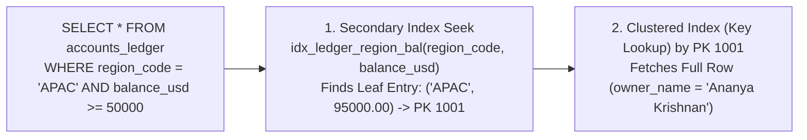

---
tags:
  - sql
  - views-indexes-transactions
  - advanced-sql
---

# Views, Indexes, Transactions & Stored Procedures in SQL

#### TL;DR (Quick Revision)

**Production Database Objects** = **Views** (`CREATE VIEW` for reusable security/query layers), **B-Tree Indexes** (`CREATE INDEX` for $O(\log N)$ SARGable lookups), **ACID Transactions & Savepoints** (`START TRANSACTION`, `SAVEPOINT`, `COMMIT`, `ROLLBACK`), and **Stored Procedures** (`CREATE PROCEDURE`).

> [!abstract] Core Idea
> To round out your complete SQL mastery beyond basic querying, a production engineer must understand the four core database architecture pillars: **Views** ([Restrictions on Views in MySQL 8.4](https://dev.mysql.com/doc/refman/8.4/en/view-restrictions.html)), **Clustered & Nonclustered B-Tree Indexes** ([SQL Server Index Architecture and Design Guide](https://learn.microsoft.com/en-us/sql/relational-databases/sql-server-index-design-guide?view=sql-server-ver17)), **Transaction Isolation Levels & Savepoints** ([InnoDB Multi-Versioning](https://dev.mysql.com/doc/refman/8.4/en/innodb-multi-versioning.html)), and **Stored Procedures** ([MySQL CALL Statement](https://dev.mysql.com/doc/refman/8.4/en/call.html)). `[VERIFY]`

> [!question] Why Use It?
>
> - **Row & Column Security Abstraction (`CREATE VIEW`)**: Expose `v_public_vip_accounts` (hiding sensitive `balance_usd` or `ssn` columns) to reporting analysts without granting direct `SELECT` permissions on the underlying `accounts_ledger` table.
> - **Turn $O(N)$ Table Scans into $O(\log N)$ Index Seeks (`CREATE INDEX`)**: A B-Tree index lets the engine jump straight to matching rows in 3–4 page reads instead of scanning millions of rows ([Avoiding Full Table Scans](https://dev.mysql.com/doc/refman/8.4/en/table-scan-avoidance.html)).
> - **Fine-Grained Transaction Recovery (`SAVEPOINT`)**: Roll back just a failed sub-step of a complex transaction (`ROLLBACK TO SAVEPOINT sp_1`) without aborting the entire transaction!
> - **Server-Side Encapsulation (`CREATE PROCEDURE`)**: Bundle parameterized multi-step SQL logic on the database server to reduce network round-trips.

#### Quick Comparison Table

| Database Pillar | ANSI SQL / SQL Server (T-SQL) | MySQL 8.4+ Equivalent | Key Architectural Behavior |
| :--- | :--- | :--- | :--- |
| **1. Views (`CREATE VIEW`)** | `CREATE OR ALTER VIEW dbo.v_name AS SELECT ...;` | `CREATE OR REPLACE VIEW v_name AS SELECT ...;` | Stores the **query definition**, not physical data (except T-SQL **Indexed Views** `WITH SCHEMABINDING`). |
| **2. Clustered vs. Nonclustered Indexes** | **1 Clustered Index** (sorts physical table pages) + up to 999 **Nonclustered Indexes** (supports `INCLUDE (cols)` & `WHERE` filtered indexes!) ([Index Design Guide](https://learn.microsoft.com/en-us/sql/relational-databases/sql-server-index-design-guide?view=sql-server-ver17)) | `PRIMARY KEY` is **always** the Clustered Index in InnoDB; all other `CREATE INDEX` indexes are secondary B-Tree indexes storing the PK in their leaf nodes | Composite index `(region_code, balance_usd)` follows the **Leftmost Prefix Rule** (`WHERE region_code = ...` uses the index; `WHERE balance_usd = ...` alone cannot!). |
| **3. Transactions & Savepoints** | `BEGIN TRAN; SAVE TRAN sp1; ROLLBACK TRAN sp1; COMMIT TRAN;` | `START TRANSACTION; SAVEPOINT sp1; ROLLBACK TO SAVEPOINT sp1; COMMIT;` ([MySQL ACID](https://dev.mysql.com/doc/refman/8.4/en/mysql-acid.html)) | `ROLLBACK TO SAVEPOINT` undoes changes after `sp1` while keeping earlier changes in the transaction active. |
| **4. Isolation Levels** | `READ UNCOMMITTED`, **`READ COMMITTED` (Default)**, `REPEATABLE READ`, `SNAPSHOT`, `SERIALIZABLE` | `READ UNCOMMITTED`, `READ COMMITTED`, **`REPEATABLE READ` (Default)**, `SERIALIZABLE` ([InnoDB MVCC](https://dev.mysql.com/doc/refman/8.4/en/innodb-multi-versioning.html)) | Controls trade-off between concurrency and phenomena (**Dirty Reads**, **Non-Repeatable Reads**, **Phantom Reads**). |
| **5. Stored Procedures** | `CREATE PROCEDURE dbo.sp_pay @id INT AS BEGIN ... END; EXEC dbo.sp_pay @id = 1;` | `CREATE PROCEDURE sp_pay(IN p_id INT) BEGIN ... END; CALL sp_pay(1);` ([CALL Statement](https://dev.mysql.com/doc/refman/8.4/en/call.html)) | Can accept `IN`/`OUT` parameters, run `DML`/`TCL`, and return multiple result sets (unlike UDFs). |

---

## The Learning Concept

### What Problem Does It Solve?

Even after creating a composite B-Tree index `CREATE INDEX idx_ledger_region_bal ON accounts_ledger(region_code, balance_usd);`, developers frequently write **non-SARGable** queries that prevent the database from using the index:

```sql
-- BAD - Non-SARGable queries that disable the B-Tree index on (region_code, balance_usd)!
-- Mistake 1: Skipping the leading column 'region_code' (Violates Leftmost Prefix Rule!)
SELECT * FROM accounts_ledger WHERE balance_usd >= 50000.00;

-- Mistake 2: Wrapping the indexed column inside a function (Forces a full Index/Table Scan!)
SELECT * FROM accounts_ledger WHERE LOWER(region_code) = 'apac';
```

A composite B-Tree index `(region_code, balance_usd)` is sorted **first by `region_code`**, and only sorted by `balance_usd` **within the same `region_code`** (just like a phonebook sorted by `Last Name, First Name`—you cannot use the phonebook's sort order if you only know someone's `First Name`!). Here is the SARGable pattern that triggers an instant B-Tree Index Seek:

```sql
-- GOOD - SARGable predicate supplying the leading column 'region_code' bare on one side!
SELECT acct_id, owner_name, region_code, balance_usd
FROM accounts_ledger
WHERE region_code = 'APAC'
  AND balance_usd >= 50000.00;
```

### How SQL Implements It

> [!tip] The 4 Transaction Isolation Levels & Phenomena Matrix
>
> 1. **`READ UNCOMMITTED`**: Allows **Dirty Reads** (reading uncommitted changes of another transaction that might later roll back!), **Non-Repeatable Reads**, and **Phantom Reads**.
> 2. **`READ COMMITTED` (SQL Server Default)**: Prevents Dirty Reads; still allows Non-Repeatable Reads (same row changes value if read twice) and Phantom Reads (new rows appear).
> 3. **`REPEATABLE READ` (MySQL 8.4 InnoDB Default)**: Prevents Dirty Reads and Non-Repeatable Reads (and InnoDB's MVCC + Next-Key Locks also prevent Phantom Reads!).
> 4. **`SERIALIZABLE`**: Strictest isolation; prevents all three phenomena by locking ranges or serializing snapshot execution.

#### Full Runnable Example

```sql
-- Step 1: Create accounts_ledger, a composite B-Tree INDEX, and a security VIEW
CREATE TABLE accounts_ledger (
    acct_id INT PRIMARY KEY,
    owner_name VARCHAR(50) NOT NULL,
    region_code VARCHAR(10) NOT NULL,
    balance_usd DECIMAL(12, 2) NOT NULL CHECK (balance_usd >= 0.00),
    is_vip INT NOT NULL DEFAULT 0
);

CREATE INDEX idx_ledger_region_bal
ON accounts_ledger(region_code, balance_usd);

CREATE VIEW v_public_vip_accounts AS
SELECT
    acct_id,
    owner_name,
    region_code
FROM accounts_ledger
WHERE is_vip = 1;

-- Step 2: Insert 3 accounts and demonstrate SAVEPOINT partial rollback
INSERT INTO accounts_ledger VALUES
(1001, 'Ananya Krishnan', 'APAC', 85000.00, 1),
(1002, 'Vikramaditya Rao', 'APAC', 42000.00, 0),
(1003, 'Siddharth Nair', 'EMEA', 120000.00, 1);

SAVEPOINT sp_before_bonus;
-- Accidentally give bonus to non-VIP account 1002:
UPDATE accounts_ledger SET balance_usd = balance_usd + 5000.00 WHERE acct_id = 1002;
-- Undo ONLY the accidental update by rolling back to the savepoint:
ROLLBACK TO SAVEPOINT sp_before_bonus;
-- Apply the $10,000 bonus to VIP account 1001:
UPDATE accounts_ledger SET balance_usd = balance_usd + 10000.00 WHERE acct_id = 1001;

-- Step 3: Query through the security View joined to the ledger
SELECT
    v.acct_id,
    v.owner_name,
    v.region_code,
    a.balance_usd AS current_balance_after_savepoint
FROM v_public_vip_accounts AS v
INNER JOIN accounts_ledger AS a
    ON v.acct_id = a.acct_id
ORDER BY v.acct_id ASC;
```

**Output:**

```
+-----------+-----------------+---------------+-----------------------------------+
| acct_id   | owner_name      | region_code   | current_balance_after_savepoint   |
|-----------+-----------------+---------------+-----------------------------------|
| 1001      | Ananya Krishnan | APAC          | 95000                             |
| 1003      | Siddharth Nair  | EMEA          | 120000                            |
+-----------+-----------------+---------------+-----------------------------------+
```

### Visual Diagram: Clustered vs. Secondary Nonclustered B-Tree Index Lookup



### Key Terminology

1. **Clustered Index vs. Secondary (Nonclustered) Index**: A **Clustered Index** determines the physical sort order of the actual table rows on disk (maximum **1 per table**—always the `PRIMARY KEY` in MySQL InnoDB). A **Secondary / Nonclustered Index** is a separate B-Tree structure sorted by the indexed columns whose leaf nodes store the row's `PRIMARY KEY` pointer ([SQL Server Index Design Guide](https://learn.microsoft.com/en-us/sql/relational-databases/sql-server-index-design-guide?view=sql-server-ver17)).
   Syntax: `CREATE INDEX idx_ledger_region_bal ON accounts_ledger(region_code, balance_usd);`
2. **SARGable Predicate (Search Argument Able)**: A `WHERE` condition (`WHERE region_code = 'APAC'` or `WHERE created_at >= '2026-01-01'`) where the indexed column stands alone on one side of the comparison operator, allowing the engine to perform a fast B-Tree **Index Seek** rather than scanning every row.
   Syntax: `WHERE balance_usd >= 50000.00` (SARGable) vs. `WHERE balance_usd * 1.10 >= 55000.00` (Non-SARGable!)
3. **View (`CREATE VIEW ... WITH CHECK OPTION`)**: A virtual table defined by a saved `SELECT` query. Adding **`WITH CHECK OPTION`** at the end of an updatable view prevents `INSERT`/`UPDATE` statements executed through the view from creating rows that would disappear from the view (e.g., setting `is_vip = 0` through `v_public_vip_accounts`)!
   Syntax: `CREATE VIEW v_vip AS SELECT acct_id, is_vip FROM accounts_ledger WHERE is_vip = 1 WITH CHECK OPTION;`
4. **Stored Procedure vs. User-Defined Function (UDF)**: A **Stored Procedure** (`CALL sp_name()` in MySQL; `EXEC sp_name` in T-SQL) is invoked as a standalone statement, can modify data (`INSERT`/`UPDATE`/`DELETE`), manage transactions (`COMMIT`), and return `OUT` parameters. A **Scalar/Table UDF** is invoked *inside* a `SELECT` or `WHERE` expression, cannot execute transactions, and must return a value.
   Syntax: `CALL sp_transfer_funds(1001, 1002, 500.00);`

> [!important] Key Rules to Remember
>
> - **The Leftmost Prefix Rule for Composite Indexes** → An index on `(A, B, C)` supports queries filtering on `(A)`, `(A, B)`, or `(A, B, C)`. It **cannot** be used for an index seek if `A` is missing from the `WHERE` clause (e.g., `WHERE B = 10 AND C = 20`)!
> - **Don't Over-Index Write-Heavy Tables** → Every `INSERT`, `UPDATE`, and `DELETE` on a table must also update every B-Tree index on that table. Create indexes strategically for actual read/join patterns.
> - **Invisible Indexes in MySQL 8.4 (`ALTER INDEX ... INVISIBLE`)** → Before dropping an index in MySQL 8.4, run `ALTER TABLE tbl ALTER INDEX idx_name INVISIBLE;` ([Invisible Indexes MySQL 8.4](https://dev.mysql.com/doc/search/?q=hint&d=371&p=5)) to hide it from the optimizer while keeping it up-to-date—if query latency spikes, you can make it `VISIBLE` again in 1 millisecond without rebuilding it!
> - **`INCLUDE` Columns in SQL Server Nonclustered Indexes** → In SQL Server T-SQL, `CREATE NONCLUSTERED INDEX idx ON tbl(region_code) INCLUDE (owner_name);` attaches `owner_name` to the index leaf pages without bloating the B-Tree intermediate sort keys—creating a fast **Covering Index**!

---

## Edge Case Analysis

### 1. Updatable Views & `WITH CHECK OPTION`
**Problem:** A view is only directly updatable (`UPDATE v_public_vip_accounts SET ...`) if it maps 1-to-1 to a single base table (no `GROUP BY`, `DISTINCT`, `UNION`, or window functions, [Restrictions on Views MySQL 8.4](https://dev.mysql.com/doc/refman/8.4/en/view-restrictions.html)). Even on an updatable view, what stops a user from updating `is_vip = 0` so the row vanishes from the view?
**Fix:** Append **`WITH CHECK OPTION`** to the `CREATE VIEW` definition.

```sql
-- WITH CHECK OPTION rejects any INSERT/UPDATE through the view that violates WHERE is_vip = 1
-- CREATE VIEW v_vip_guarded AS
-- SELECT acct_id, owner_name, is_vip FROM accounts_ledger WHERE is_vip = 1
-- WITH CHECK OPTION;
```

### 2. Inspecting Query Execution Plans (`EXPLAIN` in MySQL 8.4 vs. `SET STATISTICS IO` in T-SQL)
**Problem:** How do you prove whether your query actually used `idx_ledger_region_bal` or fell back to a slow full table scan (`type: ALL` in MySQL / `Table Scan` in T-SQL)?
**Fix:** Prefix your query with `EXPLAIN` (or `EXPLAIN ANALYZE` in MySQL 8.0.18+ / 8.4):

```sql
-- Inspecting the execution plan to verify idx_ledger_region_bal is used
EXPLAIN QUERY PLAN
SELECT acct_id, balance_usd
FROM accounts_ledger
WHERE region_code = 'APAC' AND balance_usd >= 50000.00;
```

### 3. Deadlocks & Lock Ordering Across Concurrent Transactions
**Problem:** Transaction 1 locks `acct_id = 1001` and then tries to lock `acct_id = 1002`. At the exact same millisecond, Transaction 2 locks `acct_id = 1002` and tries to lock `acct_id = 1001`. Neither can proceed (**Deadlock**)!
**Fix:** The database engine automatically detects the cycle and rolls back one victim (`ERROR 1213` in MySQL; `Msg 1205` in T-SQL). Prevent deadlocks by **always updating rows in ascending primary key order (`1001` first, then `1002`)** across all transactions!

```sql
-- Always lock/update accounts in ascending acct_id order to prevent circular deadlocks
START TRANSACTION;
UPDATE accounts_ledger SET balance_usd = balance_usd - 100.00 WHERE acct_id = 1001;
UPDATE accounts_ledger SET balance_usd = balance_usd + 100.00 WHERE acct_id = 1002;
COMMIT;
```

---

## Going Deeper (Intermediate -> Advanced)

### 1. Concurrency Phenomena Across the 4 ANSI Isolation Levels

| Isolation Level | Dirty Read? | Non-Repeatable Read? | Phantom Read? |
| :--- | :--- | :--- | :--- |
| **`READ UNCOMMITTED`** | Possible | Possible | Possible |
| **`READ COMMITTED`** (T-SQL Default) | **Prevented** | Possible | Possible |
| **`REPEATABLE READ`** (MySQL Default) | **Prevented** | **Prevented** | Possible in ANSI (**Prevented in MySQL InnoDB via Next-Key Locks & MVCC!**) |
| **`SERIALIZABLE`** | **Prevented** | **Prevented** | **Prevented** |

---

## Interview Corner

### Common Questions & Concise Answers

**Q1: What is the difference between a Clustered Index and a Nonclustered (Secondary) Index?**  
A: A **Clustered Index** sorts and stores the actual data rows of the table on disk in key order (so a table can have **only one** clustered index). A **Nonclustered / Secondary Index** is a separate B-Tree structure whose leaf nodes contain the indexed key columns plus a pointer (the Clustered Primary Key) back to the base table row.

**Q2: Explain the Leftmost Prefix Rule using an index on `(region_code, dept_id, salary_usd)`.**  
A: Because the B-Tree is sorted first by `region_code`, then by `dept_id`, and finally by `salary_usd`, a query can only seek into the index if it filters on a **leftmost prefix**: `(region_code)`, `(region_code, dept_id)`, or `(region_code, dept_id, salary_usd)`. Filtering only on `WHERE salary_usd > 100000` (without `region_code`) cannot seek this index.

**Q3: Does a standard SQL View (`CREATE VIEW`) store data on disk or speed up queries?**  
A: **No.** A standard view is a saved query definition (virtual table); when you query the view, the optimizer merges the view's SQL into your outer query and reads the base tables. (Only a Materialized View or SQL Server **Indexed View** created `WITH SCHEMABINDING` and a unique clustered index physically stores data on disk.)

**Q4: Define Dirty Read, Non-Repeatable Read, and Phantom Read.**  
A: **Dirty Read**: reading uncommitted data from another transaction that might roll back. **Non-Repeatable Read**: reading the same row twice in one transaction and getting different values because another transaction updated and committed that row in between. **Phantom Read**: running the same range query twice in one transaction and seeing newly inserted rows ("phantoms") appear.

**Q5: What is the difference between a Stored Procedure and a User-Defined Function (UDF)?**  
A: A **Stored Procedure** is called via `CALL`/`EXEC`, can perform `INSERT`/`UPDATE`/`DELETE`, can commit/rollback transactions, and can return 0, 1, or multiple result sets. A **UDF** can be called inline inside a `SELECT` or `WHERE` clause, must return a single scalar value (or table), and cannot manage transactions or modify unrelated tables.

### Interactive Revision Quiz

**Q1: How many Clustered Indexes can a single relational table have?**
- [ ] A) Unlimited
- [ ] B) Up to 16
- [ ] C) At most 1 (because rows on disk can only be physically sorted in one order!)
- [ ] D) Exactly 2 (one ascending, one descending)

**Q2: A table has a composite B-Tree index `CREATE INDEX idx_abc ON sales(region, category, sale_date);`. Which of the following `WHERE` clauses CANNOT use `idx_abc` for an index seek?**
- [ ] A) `WHERE region = 'APAC' AND category = 'Cloud' AND sale_date = '2026-11-14'`
- [ ] B) `WHERE region = 'APAC' AND category = 'Cloud'`
- [ ] C) `WHERE region = 'APAC'`
- [ ] D) `WHERE category = 'Cloud' AND sale_date = '2026-11-14'` (missing the leading column `region`!)

**Q3: Which transaction isolation level is the default in MySQL 8.4 InnoDB vs. Microsoft SQL Server?**
- [ ] A) `READ COMMITTED` in MySQL; `REPEATABLE READ` in SQL Server
- [ ] B) `REPEATABLE READ` in MySQL; `READ COMMITTED` in SQL Server
- [ ] C) `SERIALIZABLE` in both
- [ ] D) `READ UNCOMMITTED` in both

**Q4: What does `ROLLBACK TO SAVEPOINT sp_1;` do inside an active transaction?**
- [ ] A) It rolls back the entire transaction from the very beginning and closes the transaction
- [ ] B) It undoes only the statements executed *after* `SAVEPOINT sp_1` while keeping the transaction open and preserving changes made *before* `sp_1`
- [ ] C) It commits the transaction immediately
- [ ] D) It deletes the table `sp_1`

**Q5: Which of the following makes a `VIEW` non-updatable in both MySQL 8.4 and SQL Server?**
- [ ] A) Selecting a subset of columns from a single table
- [ ] B) Including a `WHERE` filter on the view
- [ ] C) Including `GROUP BY`, `HAVING`, `DISTINCT`, `UNION`, or aggregate functions like `SUM()` in the view definition
- [ ] D) Naming the view with a `v_` prefix

<details>
<summary>Show Quiz Answers & Explanations</summary>

1. **C** — Because a Clustered Index defines the physical storage order of the rows themselves, a table can have at most **1** Clustered Index.
2. **D** — By the **Leftmost Prefix Rule**, a query that skips the leading column (`region`) of `(region, category, sale_date)` cannot seek into the B-Tree.
3. **B** — MySQL InnoDB defaults to `REPEATABLE READ` ([InnoDB MVCC](https://dev.mysql.com/doc/refman/8.4/en/innodb-multi-versioning.html)), whereas SQL Server defaults to `READ COMMITTED`.
4. **B** — `ROLLBACK TO SAVEPOINT` rolls back only work done after that savepoint while keeping prior work in the transaction intact.
5. **C** — Views containing `GROUP BY`, `DISTINCT`, `UNION`, or aggregates do not map 1-to-1 to individual base table rows and cannot be directly updated.

</details>

---

## Practice Exercises

**Exercise 1: Rewrite Non-SARGable Queries for Index Seeks**
- Given `CREATE INDEX idx_emp_hire ON employees(hire_date);` and `CREATE INDEX idx_emp_sal ON employees(salary_usd);`, rewrite these two slow queries so they become SARGable:
  1. `SELECT emp_id FROM employees WHERE YEAR(hire_date) = 2026;`
  2. `SELECT emp_id FROM employees WHERE salary_usd + 10000 >= 150000;`

**Exercise 2: Create a Guarded View (`WITH CHECK OPTION`)**
- Write a `CREATE VIEW v_apac_accounts` statement on `accounts_ledger` that exposes `acct_id`, `owner_name`, `region_code`, and `balance_usd` for rows where `region_code = 'APAC'`, and add `WITH CHECK OPTION` so nobody can insert an `'EMEA'` account through the view.

**Exercise 3: Multi-Step Transaction with `SAVEPOINT`**
- Write a transaction script that inserts a new account `1004`, creates `SAVEPOINT after_insert`, updates `1004`'s balance, rolls back to `after_insert`, and then commits the transaction so `1004` remains inserted with its initial balance.

---

## Memory Trick / One-Liner

> [!tip] Textbook Dictionary (`Clustered`) vs. Back-of-Book Index (`Secondary`) Analogy
> **A Clustered Index is the dictionary itself (the pages are physically printed in `A -> Z` order); a Secondary Nonclustered Index is the index at the back of a textbook (sorted by topic, telling you which page number/`PRIMARY KEY` to flip to)—and Video Game Checkpoints are `SAVEPOINT`s!**

---

## Warning Block (Best Practice)

> [!warning] Common Mistake (Avoid This!)
>
> ```sql
> -- BAD - Wrapping an indexed column in a function or arithmetic (disables the B-Tree index!)
> SELECT acct_id, owner_name
> FROM accounts_ledger
> WHERE balance_usd / 1000.0 >= 50.0; -- Forces a full scan on every row!
> ```
>
> ```sql
> -- GOOD - Keeping the indexed column bare on the left side of the operator (SARGable Index Seek!)
> SELECT acct_id, owner_name
> FROM accounts_ledger
> WHERE balance_usd >= 50000.00;
> ```
